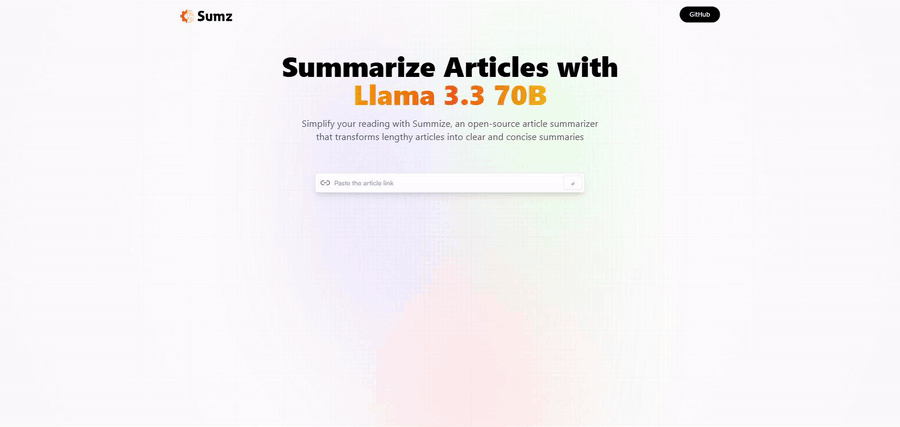

**English** | [Українська](README.uk.md)

# Summize: AI Article Summarizer

Paste a link to an article and get a summary in three or four sentences. Request history is
kept in `localStorage`, so asking for the same address again is answered instantly and without
calling the model.



---

## How it works

```
browser ──POST /api/summarize {url}──►  Vercel function
                                            │
                                            ├─► r.jina.ai  : extracts the article text
                                            │
                                            └─► Groq       : openai/gpt-oss-120b
                                                              returns the summary
```

Frontend: **React 18 + Vite + Redux Toolkit Query + TailwindCSS**.
Backend: one serverless function on **Vercel** (`api/summarize.js`), no database.

**The key lives only on the server.** In the previous version it was a `VITE_` variable, and
Vite compiles everything with that prefix into the client bundle, so the key was visible to
anyone who opened the page source. Now the browser calls its own origin, and the function
talks to the provider.

---

## Run

```bash
npm install
cp .env.example .env      # set GROQ_API_KEY
npm run dev               # http://localhost:5173
```

`npm run dev` starts both the frontend and `/api/summarize`: `vite.config.js` has a small
plugin that mounts the same function as middleware. No separate `vercel dev` is needed, and
there is no second code path for development.

| Variable | Required | Why |
|---|---|---|
| `GROQ_API_KEY` | yes | A [Groq](https://console.groq.com/keys) key: free, ~14 400 requests/day, no card |

The Node version is pinned in `engines.node` to 22.x. Vercel reads this field and it overrides
the choice in the project settings, so the build version lives in the repository, not in
someone's UI state that can quietly go stale.

---

## Why this way

**Groq, not a paid provider.** The project used to call a summarizer on RapidAPI. It stopped
working when its owner's balance ran out, and the app showed the user someone else's error
about credits. Groq has a free tier that is more than enough for a demo, and an
OpenAI-compatible API.

**r.jina.ai to read pages.** Extracting the main text of a page is a separate problem, and
doing it yourself means fighting every site's markup. Reader returns clean text, needs no key,
and is easy to replace because it sits behind one function.

**A 24 000-character limit** before sending to the model: otherwise a long page hits the
context limit and makes the request noticeably slower.

**The address is checked before the request.** The function fetches a link the user gave. Without
a check it could be asked to knock on `localhost` or an internal subnet, classic SSRF.
`assertPublicHttpUrl()` lets through only public `http`/`https`.

---

## Limits

- **No tests.** The most useful ones would cover `assertPublicHttpUrl()`: it is pure,
  deterministic, and exactly the part where a mistake is expensive.
- **No server-side cache.** `localStorage` only helps the same user in the same browser; two
  people with the same link make two requests.
- **No rate limit.** The endpoint is open, and the Groq quota can be exhausted by outside
  requests. Enough for a public demo; anything more serious needs a per-IP limit.
- **Summary quality is not measured.** There is no set of articles with reference summaries,
  so "summarizes well" is an observation, not a result.

---

## Structure

```
api/summarize.js        Serverless function: URL check, reading the article, Groq call
src/services/article.js RTK Query: one POST to /api/summarize
src/components/Demo.jsx Form, history in localStorage, loading and error states
src/components/Hero.jsx Header
vite.config.js          Plugin that mounts the function in the dev server
docs/demo.gif           Recording
```

## Deploy

Vercel picks the project up without configuration: Vite builds as static files, everything in
the `api/` folder becomes functions. The only manual step is adding `GROQ_API_KEY` in
**Settings → Environment Variables**.
